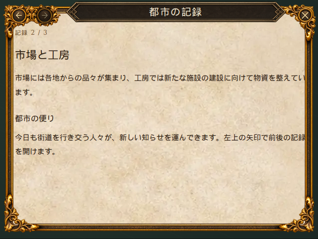

# 戻る・進むボタン付きウィンドウ

カタログの「基本部品 → ウィンドウ（戻る・進むボタン付き）」、`#navigation-window` で確認できます。



```tsx
import { NavigationWindow } from 'norden-ui'

<NavigationWindow
  title="都市の記録"
  style={{ width: 640, height: 480 }}
  onClose={close}
  onBack={goBack}
  onForward={goForward}
  backDisabled={!canGoBack}
  forwardDisabled={!canGoForward}
>
  {content}
</NavigationWindow>
```

`WindowFrame` の枠・タイトル・右上の閉じるボタンを使い、左上に金の唐草と2つの丸い台座を加えた汎用ウィンドウです。寸法・位置は `style` / `className` で指定します。本文は枠内でスクロールします。履歴と表示内容は呼び出し側で管理します。

| props | 既定値 | 動作 |
| --- | --- | --- |
| `onClose` | 必須 | 右上の閉じる操作 |
| `background` | `'parchment'` | `'parchment'`（羊皮紙）または `'dark'`（暗い地）。本文の文字色とスクロールバーも背景に合わせて切り替え |
| `draggable` | `true` | タイトルをドラッグして移動。マウス・タッチ・ペンに対応。矢印キーで10px、Shift併用で1px、Homeで元の位置に戻る |
| `position`, `onPositionChange` | `{ x: 0, y: 0 }`, 未指定 | レイアウト上の配置を基準とした移動量。`position` の変更で位置を更新し、移動時は `onPositionChange({ x, y })` で通知 |
| `onBack`, `onForward` | 未指定 | 各方向への移動。ハンドラを渡さない方向は無効 |
| `backDisabled`, `forwardDisabled` | `false` | 各方向を独立に無効化。暗い矢印と沈んだ台座で表示し、クリックとキーボード操作の対象から外す |
| `backLabel`, `forwardLabel`, `closeLabel` | `戻る`, `進む`, `閉じる` | ボタンのアクセシブルな名前とツールチップ |
| `title`, `children`, `style`, `className` | — | `WindowFrame` と共通。タイトルを省略するときは `aria-label` / `aria-labelledby` で名前を指定 |

`--norden-window-frame-size`（既定64px）で枠とナビゲーション装飾が一緒に拡縮します。装飾は幅が枠サイズの2倍、高さが枠サイズと同じで、画像の比率を保ちます。2つの操作領域の中心は装飾幅の30% / 70%、高さの50%です。最小幅は枠サイズの3.5倍です。タイトルは左右の操作領域の間に配置し、長い文字は省略します。

既存の `WindowFrame` に `navigation={{ onBack, onForward, backDisabled, forwardDisabled }}` を渡して同じ操作部を追加することもできます。`navigation` を省略した従来の枠の見た目は変わりません。

プレビューの「ウィンドウの背景」で羊皮紙と暗い地を選べます。`NavigationWindow` の初期値は羊皮紙です。`WindowFrame` 単体では既存の画面に合わせて暗い地を初期値にし、`background="parchment"` で羊皮紙を選べます。

`NavigationWindow` はタイトルでのドラッグ移動が初期状態で有効です。プレビューの「位置をリセット」で最初の配置に戻せます。`draggable={false}` またはタイトルの省略で移動操作を無効にできます。`WindowFrame` 単体で使う場合は `draggable` を指定すると移動できます。

## 生成画像

- 素材: [ornate-navigation-controls.webp](../src/assets/ui/skins/ornate-navigation-controls.webp)
- 参照画像: [ornate-close-frame.webp](../src/assets/ui/skins/ornate-close-frame.webp)
- 生成方式: 内蔵 `image_gen`、`transparent_background: true`
- 画像サイズ: 512 × 256、透過WebP（生成画像 1774 × 887 のRGBA PNGを縮小）
- 透過を維持。矢印はSVGで重ねて有効・無効状態を描画します。

生成プロンプト:

```text
Use case: ui-mockup. Asset type: production transparent PNG ornament for the upper-left navigation of the provided fantasy game window frame. Input image 1 is STYLE REFERENCE ONLY: preserve its richly sculpted polished antique GOLD acanthus leaves, dark bronze inset material, black crevices and warm highlights. Generate ONLY a compact horizontal pair of TWO EMPTY round button medallions joined together by continuous gold acanthus scrollwork, not a complete frame. Straight-on flat orthographic UI sprite; horizontal canvas aspect ratio 2:1. The two round inset faces are identical size, centered at x=30% and x=70% of canvas width, both y=50%; each round face diameter about 27% of canvas width. Outer gold rims and ornamental leaves flow around both faces and connect them into one integrated corner decoration. Outer ornament fits inside x=3%..97%, y=10%..90%. The faces are dark textured bronze, empty and clear, to receive interactive arrow glyphs in code. Truly transparent background all around the isolated silhouette, no checkerboard painted into image. No arrows, no text, no letters, no cross, no extra circles, no drop shadow outside the silhouette, no scene, no window body. Match the reference metal rendering precisely. Keep the ornament readable when displayed at 128px wide.
```
